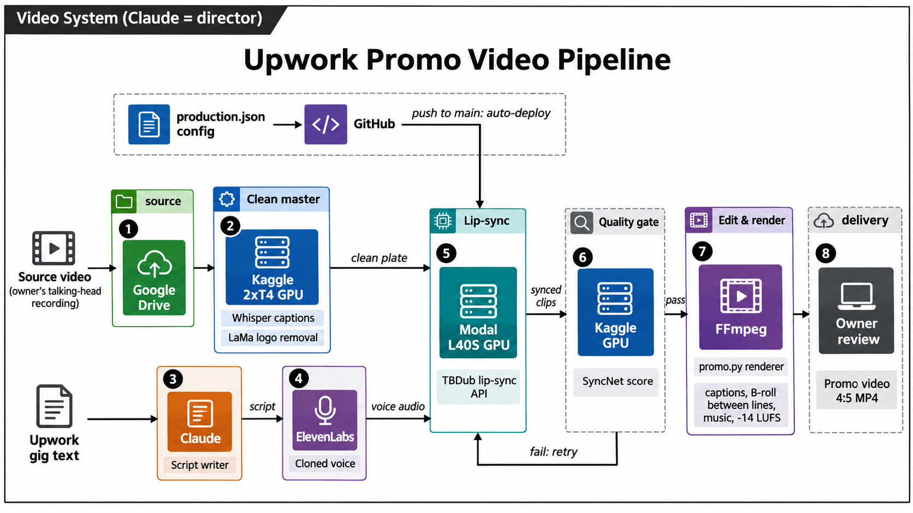
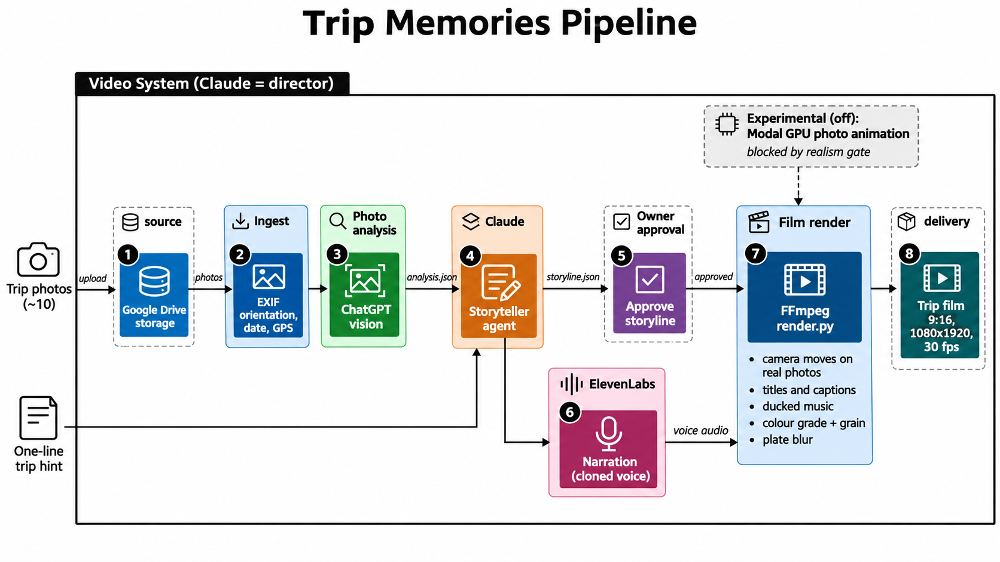

# video-system: Upwork promo videos from one source video

Plain-English driven pipeline (Claude Code + FFmpeg + free Kaggle 2×T4 GPUs). $0 so far.

## Architecture
Two production streams. Diagrams are drawn from the repo docs in the style of AWS reference architectures (see `docs/LESSONS.md` #72).

### Upwork promo videos


### Trip Memories


## Layout
```
source/      original footage (read-only, gitignored; masters live in Google Drive upwork-video-system/source)
assets/      transcripts/ (Whisper word timings), brand assets
broll/       stock / generated B-roll (gitignored)
templates/   configs (clean_master.json = regions, captions, audio, encode)
scripts/     clean_master.py, make_clean_master.sh
jobs/        Kaggle GPU jobs (transcribe = Whisper large-v3, inpaint-logo = LaMa)
lane/        kgpu.py (Kaggle GPU runner)
bin/kgpu     launcher (auto-creates .venv)
previews/    review renders (gitignored)
exports/     final renders (gitignored)
reports/     research, footage analysis, gpu-usage.jsonl
docs/        BRIEF, LESSONS, kaggle-gpu-setup, CONTINUE-PROMPT
HANDOFF.md   current status: read first
```

## Make a clean master from a branded source (one command)
```bash
scripts/make_clean_master.sh source/<video>.mp4 clean_master
```
This cuts the end card, AI-inpaints the logo (Kaggle 2×T4), replaces burned-in subtitles with new Whisper captions,
normalises audio to -14 LUFS, encodes x264 veryslow CRF 14 and runs QA (loudness, black or frozen frames).
Steps whose outputs already exist are skipped. Regions are in `templates/clean_master.json` and scale with resolution.

## Run any GPU job
```bash
bin/kgpu run jobs/<job> --input <file>   # see docs/kaggle-gpu-setup.md
bin/kgpu quota
```

## Tools and costs
FFmpeg 6.1 (LGPL/GPL), Kaggle CLI 2.2.5 (Apache-2.0), openai-whisper large-v3 (MIT), LaMa big-lama (Apache-2.0),
Inter font (OFL). Total spend: $0. GPU used: see `reports/gpu-usage.jsonl`.
